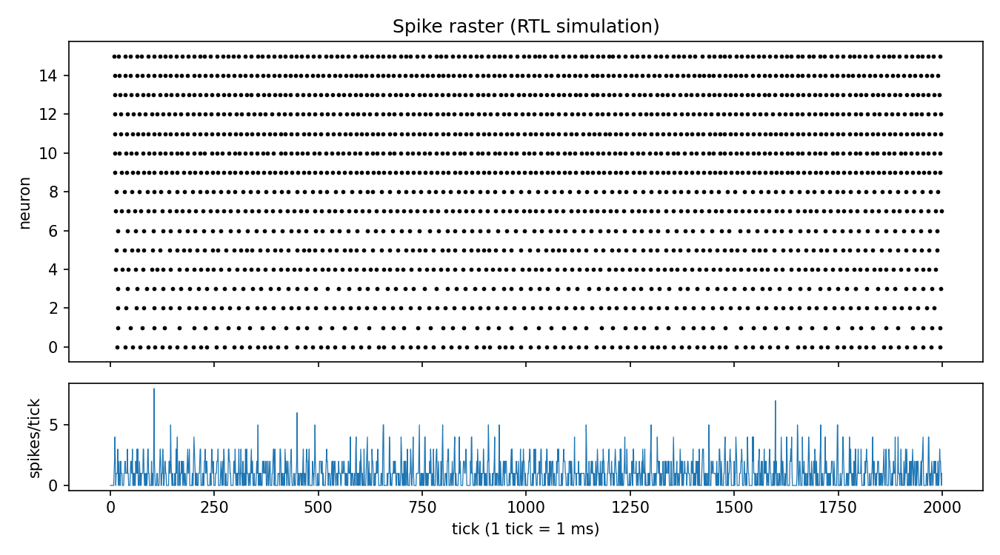

# fpga-snn-core

A parameterizable **spiking neural network core in Verilog**: 16 fixed-point Leaky Integrate-and-Fire (LIF) neurons with a sparse excitatory/inhibitory synaptic matrix, a deterministic LFSR noise source per neuron, and a UART spike-streaming wrapper for real hardware.

The RTL is verified **bit-exactly against an independent Python golden model** (2000 ticks, 1922 spikes in the reference run), so the design can be trusted before it ever touches a board.



## Why this project

Neuromorphic hardware replaces dense multiply-accumulate pipelines with event-driven spikes. This core is a small, readable reference of that idea: each neuron integrates input current, leaks, fires when it crosses a threshold, and then stays silent for a refractory period. Only 8-bit weights and a few adders are needed, so it maps onto a tiny FPGA.

## Neuron model (Q8.8 fixed point)

```
v[t+1] = v[t] - (v[t] >>> LEAK_SHIFT) + BIAS + noise + I_syn
if v[t+1] >= THRESH:  spike = 1, v = V_RESET, silent for REFRAC ticks
```

| Term | Meaning | Default |
|------|---------|---------|
| `LEAK_SHIFT` | leak = v / 2^LEAK_SHIFT (no multiplier needed) | 4 |
| `THRESH` | firing threshold, 1.0 in Q8.8 | 256 |
| `REFRAC` | refractory period in ticks | 3 |
| `BIAS` | constant drive, `BIAS_BASE + j*BIAS_STEP` so neurons are heterogeneous | 14 + j |
| `noise` | 3 low bits of a per-neuron 16-bit Galois LFSR (taps `0xB400`) | 0..7 |
| `I_syn` | sum of signed 8-bit weights of neurons that spiked on the previous tick | - |

One state update happens per `tick` pulse, so simulated "biological time" is decoupled from the clock. On the board wrapper, 1 tick = 1 ms.

## Repository layout

```
rtl/        lif_neuron.v  syn_acc.v  snn_core.v  uart_tx.v  snn_top.v
tb/         tb_snn_core.v (spike-log testbench)   tb_uart_frame.v (UART frame check)
scripts/    gen_weights.py  golden_model.py  compare.py  plot_raster.py
constraints/basys3.xdc    example pin constraints (verify against your board)
weights.hex               default synaptic matrix (src*N + dst, signed int8)
```

## Quick start (simulation, no FPGA needed)

Requirements: Icarus Verilog (`iverilog`), Python 3, and `matplotlib` for the plot.

```bash
make compare   # RTL simulation + Python golden model + tick-by-tick comparison
make plot      # writes docs/raster.png
make uart      # checks the UART frame stream of the board-level top
```

Expected output of `make compare`:

```
PASS: 2000 ticks bit-exact, 1922 total spikes
```

To try a different network, edit `N` / probabilities in `scripts/gen_weights.py`, run `make clean compare`, and keep `N` consistent in `golden_model.py` and `rtl/snn_core.v`.

## Running on hardware (Vivado)

1. Create a project, add everything in `rtl/` and `weights.hex` (set file type to *Memory Initialization*, or add it as a data file so `$readmemh` finds it).
2. Add `constraints/basys3.xdc` (or adapt the pins to your board; top module is `snn_top`).
3. Generate the bitstream and program the board.
4. Open the serial port at **115200 8N1**. Every millisecond you receive a 3-byte frame: `0xA5`, `spikes[15:8]`, `spikes[7:0]`. LEDs show neurons 0-7 with a short stretch so spikes are visible.

Simulation-verified: neuron core, synaptic accumulation, and UART framing. Timing, utilization, and on-board behavior depend on your device and should be checked in your own synthesis run.

## Ideas for extension

- Time-multiplex one neuron datapath over many neurons to trade speed for area.
- Add on-chip STDP weight updates (trace-based) in place of the static weight ROM.
- Stream spikes over AXI-Stream to a Zynq PS and visualize live.
